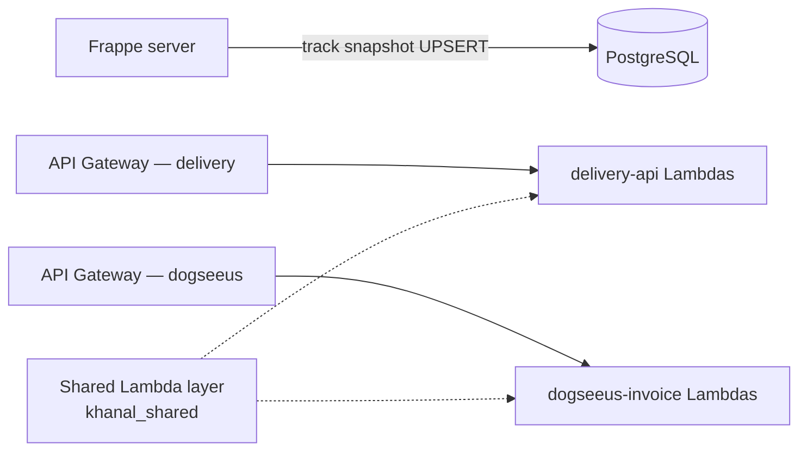
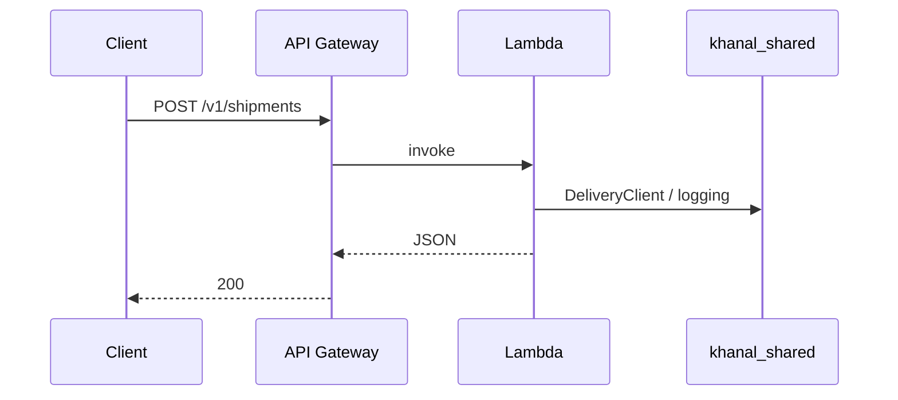

# Architecture — two services (`delivery-api`, `dogseeus-invoice`)

**delivery-api** handles **Delhivery webhooks** (shipment status + POD). **dogseeus-invoice** is a separate product surface (**Dogseeus_Invoice**) with its own HTTP API and Lambdas.



## Repository layout

```
services/delivery-api/       # Stack: Delhivery webhooks (status + POD)
services/dogseeus-invoice/   # Stack: Dogseeus_Invoice (POST /v1/dogseeus/invoices)
  dogseeus_invoice/          # Python package (avoids clashing with delivery-api `src/`)
shared/khanal_shared/        # db, http, logging, delivery helpers
layers/build/                # Built by scripts/build_shared_layer.sh
```

## Service boundaries

| Stack | Responsibility | Routes (examples) |
|-------|----------------|-------------------|
| **delivery-api** | **Delhivery webhooks** (shipment status + POD) | `POST /v1/webhooks/delhivery/shipment-status`, `POST /v1/webhooks/delhivery/pod` |
| **dogseeus-invoice** | Invoicing (stub) | `POST /v1/dogseeus/invoices` |
| **B2C_Invoice** | Walmart order sync + SAP AR Invoices | `GET /v1/walmart/*` (Cognito) |
| **amazon-us-b2c** | Amazon US SP-API → SAP AR Invoices/Credit Notes + reconciliation | scheduled Lambdas, no HTTP API (see its README) |

## Shared code

- **`khanal_shared.delivery`**: carrier / label client stub.
- **`khanal_shared.db`**: optional PostgreSQL via RDS Proxy (same patterns as [DATABASE.md](DATABASE.md)).

## Deployment

1. `bash scripts/build_shared_layer.sh`
2. `cd services/delivery-api && npm install && npx serverless deploy --stage dev`
3. `cd services/dogseeus-invoice && npm install && npx serverless deploy --stage dev`

Each command updates **only that stack** in AWS (separate API Gateway + Lambdas).

GitHub Actions: see `.github/workflows/ci.yml` and `deploy.yml` (OIDC + workflow_dispatch).

## Data & secrets

- Keep **secrets out of git**; inject credentials via Lambda environment or SSM/Secrets resolved in CI before deploy.
- PostgreSQL layout remains in [DATABASE.md](DATABASE.md) (trim tables you do not need).

## Request lifecycle (example)



## Scalability notes

- **Independent stacks** give separate scaling and blast radius for delivery vs invoicing.
- Add **SQS** when work becomes slow or spiky; keep HTTP handlers thin and enqueue heavy work.
- Add **RDS Proxy** when connecting Lambdas to PostgreSQL.
